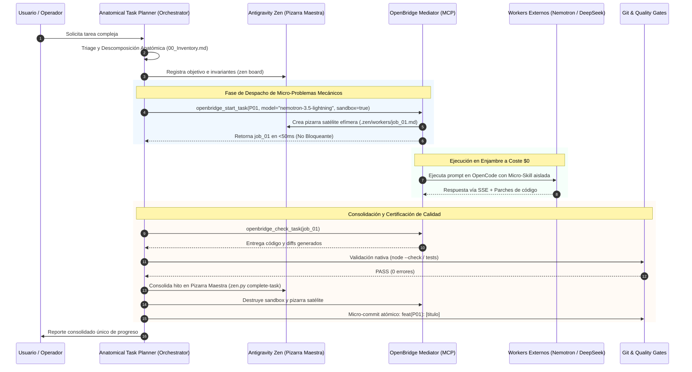

# ARQUITECTURA MAESTRA DE INTERCONEXIÓN: PLANIFICADOR, ZEN, OPENBRIDGE Y ENJAMBRES

**Identificador de Diseño:** `MASTER-ARCHITECTURE-V1`  
**Estado:** Certificado para Implementación Gradual  
**Ecosistema:** Antigravity (Gemini 3.8) ➔ Mediador OpenBridge ➔ OpenCode Zen Workers

---

## 1. Diagrama de Flujo y Topología de Componentes

---

## 2. Los 4 Pilares del Desacoplamiento

### Pilar 1: Independencia Absoluta de Antigravity Zen
* `antigravity-zen` no importa módulos de OpenBridge ni depende de OpenCode.
* La carpeta `.zen/workers/` es puramente opcional: si el desarrollador no usa OpenBridge, Zen se comporta exactamente como hoy (una Pizarra Maestra única para un solo agente).

### Pilar 2: Especialización de Anatomical Task Planner
* Deja de llamarse "orquestador de agentes" y se enfoca al 100% en:
  - Detección de casos de borde y contratos de tipos en `00_Inventory.md`.
  - Construcción del grafo DAG en `Execution_Workflow.md`.
  - Aplicación de compuertas de calidad sin comprobadores Python inventados.

### Pilar 3: Aislamiento Cognitivo de Workers (Micro-Skills)
* Las skills extensas de Antigravity (que superan los 2.000 tokens) se mantienen exclusivamente en la ventana de Gemini 3.8.
* A los workers en OpenCode solo se les inyectan **Micro-Skills Quirúrgicas** (<150 tokens) creadas en `.agents/skills/workers/`:
  - `worker-test-runner.md`
  - `worker-dto-scaffolder.md`
  - `worker-ui-checker.md`

### Pilar 4: Arbitraje Dinámico por Perfil de Carga
* OpenBridge no delega a ciegas a un solo modelo:
  - Si la tarea contiene `tests` o `algoritmo` ➔ Asigna **`nemotron-3.5-lightning-free`**.
  - Si la tarea contiene `ui`, `css` o `pantalla` ➔ Asigna **`nemotron-3.5-super-vl-free`**.
  - Si la tarea contiene `boilerplate` o `interfaces` ➔ Asigna **`deepseek-v4.1-flash-free`**.
  - Si la tarea es de `alta complejidad lógica` ➔ Asigna **`nemotron-3-ultra-550b:free`**.
